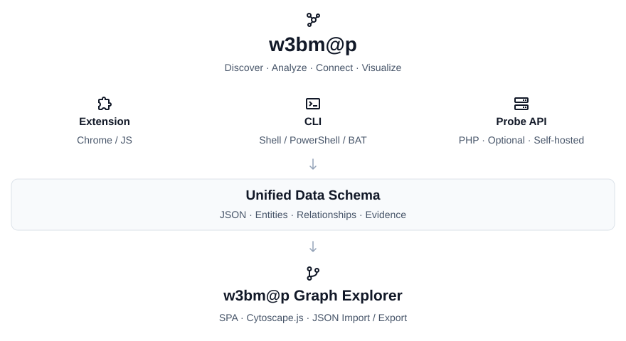

<p align="center">
  
</p>

# w3bm@p

An open source platform for web technology discovery and infrastructure mapping.
Discover technologies, map pages and infrastructure, and explore their connections
while keeping control of your data and collection infrastructure.

> **Status:** the unpacked Chrome extension, PHP connector, SH/BAT CLI, and Graph
> Explorer are implemented. A native PowerShell collector and cross-run correlation
> are still planned. The extension's native Chrome installation checks are manual.

## Architecture

w3bm@p follows a local-first architecture with no required account, database, or
central backend. Independent collectors produce a shared JSON format that can be
imported and visualized in the Graph Explorer.

| Component | Responsibility | Technologies and status |
| --- | --- | --- |
| Extension | Analyze the current page, discover technology indicators, optionally query the user's connector, and open the packaged graph | JavaScript, Chrome Manifest V3 — unpacked version implemented |
| PHP Connector / Probe API | Enrich discoveries with DNS, RDAP, certificates, HTTP, and other public sources | PHP 8.1+, cURL, OpenSSL — implemented |
| CLI | Collect data from the terminal and export JSON in standalone or connected mode | SH/BAT launchers with PHP classes — implemented; native PowerShell planned |
| Graph Explorer | Import, filter, inspect, visualize, and export entities, relationships, and evidence | JavaScript SPA, Cytoscape.js — implemented; cross-run correlation planned |
| Shared | Define the JSON graph contract and browser technology indicators | JSON Schema and browser fingerprint catalog — implemented |

## Quick start

Install PHP 8.1+ with cURL, OpenSSL, DOM, and SimpleXML for all modules. From the
repository root, run a standalone collection:

```sh
sh cli/w3bmap.sh --domain example.com --modules dns,headers,ssl,technologies
```

On Windows Command Prompt:

```bat
cli\w3bmap.bat --domain example.com --modules dns,headers,ssl,technologies
```

Or invoke PHP directly on either platform:

```sh
php cli/w3bmap.php --help
php cli/w3bmap.php --action capabilities
```

Read the [CLI guide](docs/cli.md) for exports, connected mode, requirements, and
exit codes. Read the [connector guide](docs/connector.md) to deploy the authenticated
single-file PHP API and configure its authentication token.

To view exported collections, serve the static Explorer:

```sh
php -S 127.0.0.1:8081 -t explorer
```

Open `http://127.0.0.1:8081/` and choose **Import collection**, or explore the
synthetic sample. No npm installation or build is required to use it. Read the
[Explorer guide](docs/explorer.md) for filters, evidence inspection, privacy,
import limits, and development commands.

To use the Chrome extension, open `chrome://extensions/`, enable **Developer mode**,
choose **Load unpacked**, and select this repository's `extension/` directory.
Its Explorer and fingerprints are already included. Open an HTTP/HTTPS page and
click the extension to detect technologies automatically. The popup groups 80
supported technologies by category, shows explicit versions and evidence, and
supports filtering. The popup displays the site's favicon and local technology
logos, with discovery tabs and counters. All application and technology icons
come from [Iconify collections](shared/iconify/README.md) and are packaged locally.
Choose **Analyze current page** to save a graph with links,
resources, and optional PHP enrichment. Read the
[extension guide](docs/extension.md) for installation, optional connector settings,
privacy, and verification.

### Optional self-hosted PHP connector

Each user installs `w3bmap.php` on their own hosting service, VPS, or local
server and configures its URL and authentication key in the extension.
Open `probe/install.php` to generate the key and save settings in a private
`.env` outside the public web root. No Apache configuration changes are needed.
**The project does not provide a public or centralized PHP endpoint.** Browser
collection remains available without the connector.

The workflow is:

1. Install the Chrome extension.
2. Optionally install the PHP connector on a server you control.
3. Enter the connector URL and authentication key in the extension settings.
4. Test the connection and discover the server's available modules.
5. Enrich browser discoveries with connector queries.
6. Explore the combined graph and export the results as JSON.

The CLI supports **standalone** mode using the local PHP runtime and **connected**
mode using the same PHP connector protocol.

### Engineering principles

- **English throughout:** documentation, source code, identifiers, comments,
  interface text, errors, examples, and commit messages must be in English.
- **Object-oriented programming:** implement application behavior through classes
  with clear responsibilities, encapsulation, and composition. Keep entry points
  thin and delegate behavior to objects.
- **Model–View–Controller wherever applicable:** models represent entities and
  application state; views render interfaces or serialize responses; controllers
  coordinate input and application services. Keep collection, networking, and
  correlation logic in dedicated service classes.
- **Language-appropriate launchers:** Shell and BAT scripts remain thin launchers
  for object-oriented application code, since those languages do not provide
  native class-based OOP. PowerShell application behavior should use classes.
- **Independent components, shared contracts:** preserve a common versioned data
  format while allowing each collector to operate independently.

The single-file PHP distribution will preserve internal class boundaries.

## Repository structure

```text
w3bmap/
├── extension/          # Unpacked Chrome extension, connector settings, packaged Explorer
├── cli/                # w3bmap.sh, w3bmap.bat, and the PHP CLI application
├── probe/              # w3bmap.php, distributed as a single file
├── explorer/           # Static graph interface, MVC source, and local libraries
├── shared/             # schema.json and browser fingerprints.json
├── tests/              # Offline PHP regression suite
├── docs/               # CLI, connector, and Explorer guides and artwork
├── AGENTS.md           # Repository instructions for coding agents
├── CONTRIBUTING.md
├── LICENSE
└── README.md
```

Application code separates models, views, controllers, and services.
The connector remains deployable as one file; the CLI shares its classes.

Domains, pages, technologies, IPs, certificates, and sitemaps have collapsible
presentation groups in the extension and Explorer. Grouping preserves original
entities, evidence, and JSON exports. See [grouping rules](docs/explorer.md#collapsible-groups).

## Data contract

Collectors share versioned JSON containing entities (`nodes`), relationships
(`edges`), collection metadata, module results, and errors. Discoveries record
source, collection time, evidence, and confidence; relationships distinguish
observed findings from inferred associations. The contract is defined in
[shared/schema.json](shared/schema.json). Cross-run correlation is still planned.

Simplified excerpt (full documents also include metadata, status, evidence,
confidence, module results, and errors):

```json
{
  "schema_version": "1.0",
  "tool": "w3bm@p",
  "target": "example.com",
  "source": "extension",
  "nodes": [
    { "id": "domain:example.com", "type": "domain", "label": "example.com" },
    { "id": "page:https://example.com/about", "type": "page", "label": "/about" }
  ],
  "edges": [
    {
      "source": "domain:example.com",
      "target": "page:https://example.com/about",
      "type": "contains"
    }
  ]
}
```

## Connector API

The PHP connector is distributed as a single file, without a mandatory Composer
installation or database. All operations require bearer-token authentication,
including capabilities. The optional `install.php` setup page generates
`W3BMAP_API_KEY` and writes the private `.env`
automatically. See the [installation guide](docs/connector.md). The following
actions are implemented:

```text
GET  /w3bmap.php?action=capabilities
GET  /w3bmap.php?action=dns&domain=example.com
GET  /w3bmap.php?action=rdap&domain=example.com
GET  /w3bmap.php?action=ssl&domain=example.com
GET  /w3bmap.php?action=headers&domain=example.com
GET  /w3bmap.php?action=technologies&domain=example.com
GET  /w3bmap.php?action=sitemap&domain=example.com
GET  /w3bmap.php?action=robots&domain=example.com
GET  /w3bmap.php?action=links&domain=example.com
POST /w3bmap.php?action=analyze
```

Modules cover DNS, RDAP, certificates, HTTP headers, technology indicators,
robots.txt, sitemaps, and links. Optional PHP environment diagnostics are disabled
by default. Local directory inspection and recursive crawling are not implemented.
See [the connector protocol and limits](docs/connector.md) for request bodies,
deployment settings, security boundaries, and partial-result behavior.

### Security boundaries

- Token authentication for every operation, including capabilities, and HTTPS for remote endpoints.
- Extension origin permissions granted for the hosts in use.
- Limits on request rates, execution time, and response sizes.
- Validation and authorization of connector query destinations.
- Blocking of private, loopback, and cloud metadata destinations by default, including DNS resolution and redirect validation.
- Credentials excluded from versioned source and exported JSON.
- Route discovery through links and sitemaps; no directory brute force in the API.

Queries and diagnostics must remain within the scope authorized by the operator.

## Roadmap

- [x] Initialize Git, documentation, licensing, and commit conventions.
- [x] Establish English-only content, OOP, and MVC guidelines.
- [x] Define the shared JSON graph schema.
- [x] Implement standalone and connected PHP CLI with SH/BAT launchers.
- [x] Implement the authenticated self-hosted PHP connector.
- [x] Build the Graph Explorer with import, validation, filtering, and export.
- [x] Implement the Chrome extension with current-page collection and technology indicators.
- [ ] Add a native PowerShell collector.
- [x] Integrate the optional connector and packaged Graph Explorer into the Chrome extension.
- [ ] Complete manual native Chrome installation and permission-prompt acceptance checks.
- [ ] Correlate entities and evidence from multiple sources.

## Verification

Run the offline regression suite:

```sh
php tests/run.php
php tests/install.php
php tests/install-http.php
```

The suite uses injected DNS and HTTP fixtures to check authentication, request
validation, destination policy, rate limiting, graph consistency, XML/HTML parsing,
and CLI input handling. It does not send external network requests.

Syntax checks:

```sh
php -l probe/w3bmap.php
php -l cli/w3bmap.php
sh -n cli/w3bmap.sh
```

For Explorer model, validation, and interoperability tests (Node.js 20.6+ and PHP
required), run from `explorer/`:

```sh
npm ci
npm test
```

After changing the shared schema, run `npm run vendor` in that directory to
regenerate the committed validator. Browser dependencies are local and pinned;
see [their credits and license notices](explorer/vendor/README.md).

For extension packaging and automated tests, run from `extension/`:

```sh
npm run build
npm test
```

The extension tests use Chrome API fixtures. An opt-in authenticated PHP transport
test and the required native Chrome checks are documented in
[docs/extension.md](docs/extension.md). The build copies the canonical Explorer
and fingerprint catalog; commit those generated copies after source changes.

## Contributing

Read [CONTRIBUTING.md](CONTRIBUTING.md). Commits follow
[Conventional Commits 1.0.0](https://www.conventionalcommits.org/en/v1.0.0/),
for example: `feat(extension): add connector settings`.

## License

Project code and documentation are distributed under the [MIT License](LICENSE).
Copyright (c) 2026 Hudson.

The architecture illustration uses BoxIcons v2 icons by Aniket Suvarna, obtained
through [Iconify](https://icon-sets.iconify.design/bx/). See the
[asset credits and license notices](docs/assets/README.md).
